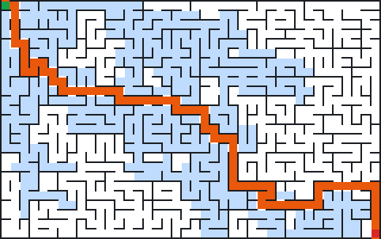
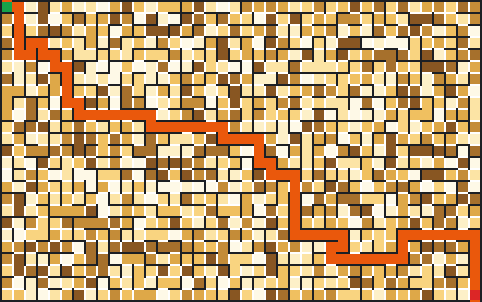
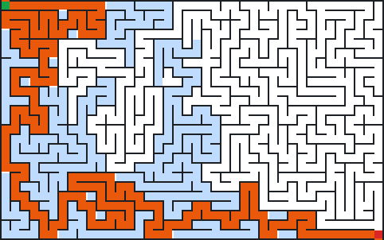

# Labirintos

Gere e resolva labirintos com vários algoritmos, em C++17 e sem dependências. São sete geradores (cada um com a sua "personalidade"), seis resolvedores, desenho no terminal em ASCII ou com caracteres de caixa, imagens PNG gravadas por um codificador escrito à mão e quadros da geração passo a passo. Um bom laboratório para estudar grafos, árvores geradoras, buscas e o formato PNG por dentro.



## Recursos

- **Geradores**: recursive backtracker (iterativo, sem recursão), Prim aleatório, Kruskal aleatório (com union-find), Wilson (passeios aleatórios com apagamento de laços), Eller (linha por linha), Aldous-Broder e divisão recursiva.
- **Trançado** (`--trancar F`): remove uma fração dos becos sem saída e cria ciclos, para os resolvedores terem mais de um caminho.
- **Resolvedores**: busca em largura (BFS), busca em profundidade (DFS), A* com distância de Manhattan, Dijkstra com células de pesos diferentes, preenchimento de becos sem saída e seguidor de parede pela mão direita.
- **Saída**: desenho em ASCII ou em caracteres de caixa Unicode; PNG com a solução e as células examinadas; `--quadros pasta` grava a geração inteira em PNGs numerados.
- **PNG feito à mão**: assinatura, blocos IHDR, PLTE, IDAT e IEND, CRC-32, fluxo zlib com blocos "stored" e Adler-32. Os arquivos são conferidos pelo `sips` do macOS e pelo `zlib` do Python nos testes.
- **Estatísticas**: becos sem saída, bifurcações, ciclos e o maior caminho do labirinto.
- **Reprodutível**: `--semente` gera sempre o mesmo labirinto, em qualquer máquina.

## Como usar

```
$ ./build/labirinto -l 16 -a 7 -s 2026 -g wilson
╷ · ╶───────┬───────┬───────────────────┬───────────────────┬───┐
│ E · ·     │       │                   │                   │   │
├───╴ · ╶───┤   ╷   ╵   ╷   ╷   ╶───┬───┼───┐   ╷   ┌───╴   ╵   │
│ · · ·     │   │       │   │       │   │   │   │   │           │
│ · ╶───┐   └───┤   ╶───┼───┤   ╷   ╵   │   │   ├───┴───┐   ╷   │
│ ·     │       │       │   │   │       │   │   │       │   │   │
│ · ┌───┘   ╶───┤   ╶───┘   ├───┼───┬───┘   ╵   ╵   ┌───┴───┤   │
│ · │           │           │   │   │               │       │   │
│ · └───────────┴───╴   ╷   │   │   └───────┐   ┌───┴───╴   │   │
│ · · · · · · · · · · · │   │   │           │   │           │   │
├───╴   ┌───────┐   ╷ · │   │   │   ╶───────┘   ├───────╴   └───┤
│       │       │   │ · │   │   │ · · · · · · · │ · · · · · · · │
│   ╶───┴───╴   ├───┘ · └───┘   ╵ · ╶───────┐ · ╵ · ╷   ╷   ╷ · │
│               │     · · · · · · ·         │ · · · │   │   │ S │
└───────────────┴───────────────────────────┴───────┴───┴───┘ · ╵
gerador: wilson, 16x7, semente 2026
solução (bfs): 27 passos, 101 de 112 células examinadas
```

`E` é a entrada (no alto à esquerda) e `S` é a saída (embaixo à direita).

Com pesos (o custo de entrar em cada célula, de 1 a 9) e o Dijkstra, o caminho escolhido é o mais barato, não o mais curto. Entre parênteses, as células do caminho:

```
$ ./build/labirinto -l 10 -a 5 -s 3 -g prim --pesos -r dijkstra --ascii
+ . +---+---+---+---+---+---+---+---+---+
| E |(3).(3).(3).(7)| 2   1 | 2 | 4 | 9 |
+ . + . +---+   + . +   +---+   +   +   +
|(8).(5)| 8   3 |(1).(7)  6   8   4   7 |
+---+   +---+   +---+ . +---+---+---+   +
| 9 | 8   3 | 6 | 9  (8)  7   3 | 4   8 |
+   +   +---+   +---+ . +---+---+---+---+
| 7   4   2 | 2   5 |(3).(5).(2).(6).(5)|
+   +   +---+   +---+   +---+---+---+ . +
| 2 | 7   2 | 5   5 | 5   3   7   7 | S |
+---+---+---+---+---+---+---+---+---+ . +
gerador: prim, 10x5, semente 3
solução (dijkstra): 15 passos, custo 67, 46 de 50 células examinadas
```

Imagens e estatísticas:

```
$ ./build/labirinto -l 40 -a 25 -s 7 -g kruskal --trancar 0.5 -r dijkstra --pesos --png pesos.png --sem-desenho --estatisticas
gerador: kruskal, 40x25, semente 7, 128 becos removidos
solução (dijkstra): 71 passos, custo 332, 999 de 1000 células examinadas
células: 1000
passagens: 1127 (128 a mais que uma árvore: há ciclos)
becos sem saída: 92 (9,2%)
bifurcações: 307
corredores: 601
maior caminho: 74 passos, de (38, 24) a (2, 8)
imagem: pesos.png (562x352 pixels)
```



Para ver a geração acontecendo, `--quadros` grava um PNG a cada N passos (com `--a-cada N`; o padrão dá cerca de 100 quadros). Células ainda fora do labirinto aparecem em cinza e a célula atual do algoritmo, em azul. Os quadros podem virar um vídeo ou GIF em qualquer editor.

```
$ ./build/labirinto -l 30 -a 20 -g wilson -s 3 --quadros quadros --celula 8 -r nenhum --sem-desenho
100 quadros gravados em quadros
```

Todas as opções:

| Opção | O que faz |
| --- | --- |
| `-l`, `--largura N` / `-a`, `--altura N` | tamanho em células (padrão 20 x 10; até 2000) |
| `-g`, `--gerador NOME` | `backtracker`, `prim`, `kruskal`, `wilson`, `eller`, `aldous-broder` ou `divisao` |
| `-s`, `--semente N` | semente do sorteio; sem ela, a semente usada aparece na saída |
| `--trancar F` | remove a fração F (de 0 a 1) dos becos sem saída |
| `--pesos` | custo de 1 a 9 em cada célula, para `dijkstra` e `astar` |
| `-r`, `--resolver NOME` | `bfs`, `dfs`, `astar`, `dijkstra`, `becos`, `mao-direita` ou `nenhum` |
| `--ascii` | desenho só com ASCII |
| `--sem-desenho` | não desenha no terminal |
| `--estatisticas` | becos, bifurcações, corredores, ciclos e maior caminho |
| `--png ARQUIVO` / `--celula N` | grava a imagem; N é o lado da célula em pixels (padrão 12) |
| `--quadros PASTA` / `--a-cada N` | grava a geração passo a passo |
| `--listar`, `--versao`, `--ajuda` | |

Códigos de saída: `0` sucesso, `1` falha ao gravar arquivos, `2` erro de uso.

## Como compilar

```
make            # gera build/labirinto
make test       # testes de unidade e de integração
make clean
```

Com CMake:

```
cmake -S . -B build
cmake --build build
ctest --test-dir build --output-on-failure
```

Testes com AddressSanitizer e UndefinedBehaviorSanitizer:

```
make clean
make test CXXFLAGS="-std=c++17 -O1 -g -fsanitize=address,undefined -fno-omit-frame-pointer -Wall -Wextra -Wpedantic"
```

Testado no macOS com Apple clang. O código usa apenas C++17 padrão (inclusive `std::filesystem` para criar a pasta dos quadros).

## Testes

- **Labirintos perfeitos**: cada gerador, em sete tamanhos (de 1x1 a 31x17, inclusive corredores 1xN e Nx1) e cinco sementes, produz uma grade conexa com exatamente células - 1 passagens. Conexo e com n - 1 arestas é o mesmo que ser uma árvore: não há ciclos. As paredes também são conferidas dos dois lados.
- **Determinismo**: a mesma semente gera o mesmo labirinto e sementes diferentes geram labirintos diferentes.
- **Viés medido**: a grade 3x3 tem exatamente 192 labirintos perfeitos possíveis. Wilson e Aldous-Broder sorteiam 19.200 labirintos e passam no teste do qui-quadrado contra a distribuição uniforme (todos os 192 aparecem); o backtracker reprova feio, como esperado. Outro teste confere que o backtracker gera menos da metade dos becos de Prim e Kruskal.
- **Resolvedores**: em labirintos perfeitos, os seis devolvem exatamente o mesmo caminho (é único). Com ciclos, BFS, A*, Dijkstra e o preenchimento de becos concordam no comprimento do menor caminho e o A* nunca examina mais células que o Dijkstra. Com pesos, o custo do Dijkstra e do A* é conferido contra um Bellman-Ford escrito no teste.
- **PNG**: CRC-32 e Adler-32 contra valores conhecidos (por exemplo, CRC-32 de "123456789" = CBF43926), fluxos zlib de 0 a 200.000 bytes lidos de volta bloco a bloco, e um PNG decodificado pelo próprio teste.
- **Integração** (`tests/integracao.sh`): todos os geradores com todos os resolvedores pela linha de comando, o PNG medido pelo `sips` (quando disponível) e decodificado pelo `zlib` do Python (`tests/confere_png.py`), a quantidade de quadros gravados e os erros de uso.
- **Fotografias**: o desenho ASCII e o Unicode de labirintos pequenos com semente fixa são comparados caractere a caractere.

## Como funciona

### Labirinto perfeito é uma árvore geradora

Pense na grade como um grafo: cada célula é um vértice e cada parede entre vizinhas é uma aresta possível. Um labirinto **perfeito** (exatamente um caminho entre quaisquer duas células, sem ciclos e sem regiões isoladas) é uma **árvore geradora** desse grafo: liga todas as células usando exatamente células - 1 passagens. Todo gerador abaixo é um jeito diferente de sortear uma árvore geradora, e cada jeito tem um **viés**: alguns tipos de árvore saem com mais frequência, e isso muda a cara do labirinto.

Comparação em labirintos de 60x60 (semente 4):

| Gerador | Becos sem saída | Maior caminho | Solução |
| --- | --- | --- | --- |
| backtracker | 10,0% | 1066 passos | 802 passos |
| prim | 35,3% | 205 | 150 |
| kruskal | 31,1% | 329 | 252 |
| wilson | 29,0% | 292 | 182 |
| eller | 28,3% | 428 | 218 |
| aldous-broder | 28,8% | 341 | 226 |
| divisao | 27,0% | 318 | 254 |

Os exemplos a seguir têm 14x6 células e semente 4.

### Recursive backtracker (`-g backtracker`)

Busca em profundidade aleatória: a partir da célula atual, anda para um vizinho ainda não visitado sorteado e abre a parede; quando não há vizinho livre, volta pela pilha (backtracking) até achar uma célula com opção. A pilha é explícita, então não há recursão e labirintos de 2000 x 2000 não estouram a pilha do programa.

**Viés**: corredores longos e sinuosos, poucos becos (cerca de 10%) e uma solução muito comprida. É o mais "difícil de olhar" e o mais fácil de resolver mentalmente, porque há poucas escolhas.



```
+   +---+---+---+---+---+---+---+---+---+---+---+---+---+
| E         |           |               |   |           |
+   +---+---+   +---+   +   +---+---+   +   +   +   +---+
|   |           |       |   |           |       |       |
+   +   +---+---+   +   +   +   +---+---+   +---+---+   +
|           |       |   |   |   |   |       |           |
+   +---+---+   +---+---+---+   +   +   +---+   +---+   +
|   |           |           |   |       |       |       |
+---+   +   +---+   +---+   +   +---+   +   +---+---+   +
|       |   |       |       |       |   |           |   |
+   +---+---+   +---+   +---+---+   +---+---+---+   +   +
|                   |                               | S |
+---+---+---+---+---+---+---+---+---+---+---+---+---+   +
```

### Prim aleatório (`-g prim`)

Mantém a **fronteira**: as células fora do labirinto que encostam em alguma célula de dentro. A cada passo sorteia uma célula da fronteira, liga-a a um vizinho que já está dentro e coloca os vizinhos dela na fronteira.

**Viés**: o labirinto cresce como uma mancha a partir do ponto inicial, com muitos becos curtos (mais de 35%) e caminhos curtos: a solução fica perto da distância em linha reta.

```
+   +---+---+---+---+---+---+---+---+---+---+---+---+---+
| E         |       |           |   |   |       |       |
+---+---+   +---+   +---+---+   +   +   +---+   +   +---+
|   |   |   |   |       |       |       |   |           |
+   +   +   +   +---+   +   +---+   +---+   +---+   +---+
|                                       |               |
+---+---+   +   +   +---+   +   +   +---+   +---+---+---+
|       |   |   |   |       |   |                       |
+   +   +   +---+---+   +   +---+---+---+   +---+---+   +
|   |           |   |   |               |       |       |
+---+---+   +---+   +   +---+---+   +---+---+---+---+---+
|           |               |                         S |
+---+---+---+---+---+---+---+---+---+---+---+---+---+   +
```

### Kruskal aleatório (`-g kruskal`)

Embaralha todas as paredes internas e percorre a lista: derruba a parede se as duas células ainda estão em conjuntos diferentes e une os conjuntos. Saber se duas células estão no mesmo conjunto é o trabalho do **union-find** (com compressão de caminho e união por tamanho), em tempo quase constante.

**Viés**: como as paredes são escolhidas em qualquer lugar da grade, não há direção preferida; muitos becos curtos, parecido com Prim, mas sem o crescimento a partir de um centro.

```
+   +---+---+---+---+---+---+---+---+---+---+---+---+---+
| E             |       |           |   |               |
+   +---+   +---+   +---+   +---+   +   +   +   +---+---+
|   |                   |       |           |   |       |
+---+   +   +---+---+---+---+---+   +   +---+   +---+   +
|       |   |   |       |           |   |   |           |
+   +---+   +   +---+   +   +---+---+---+   +   +---+---+
|   |               |       |   |   |           |   |   |
+   +---+   +   +---+---+   +   +   +   +   +   +   +   +
|       |   |                   |       |   |   |   |   |
+---+   +---+   +---+   +   +---+   +---+   +---+   +   +
|       |       |       |       |   |                 S |
+---+---+---+---+---+---+---+---+---+---+---+---+---+   +
```

### Wilson (`-g wilson`)

Começa com uma célula na árvore. De uma célula de fora, faz um **passeio aleatório** até encostar na árvore. Guardando apenas a última direção usada em cada célula, os laços do passeio se apagam sozinhos (**passeio aleatório com apagamento de laços**); o caminho que sobra é incorporado à árvore. Repete até todas entrarem.

**Viés**: nenhum. Wilson sorteia **uniformemente** entre todas as árvores geradoras possíveis (os testes conferem isso com o qui-quadrado). No começo é lento (o primeiro passeio vaga muito até achar a árvore pequena); depois acelera.

```
+   +---+---+---+---+---+---+---+---+---+---+---+---+---+
| E |       |   |       |           |                   |
+   +   +---+   +---+   +---+   +---+---+   +   +---+---+
|   |       |               |   |       |   |       |   |
+   +---+   +   +---+---+---+   +   +---+   +---+   +   +
|                                           |           |
+   +   +---+---+---+---+---+---+---+   +---+---+---+---+
|   |   |       |                   |       |       |   |
+   +---+---+   +   +---+   +---+---+---+   +---+   +   +
|   |   |               |   |       |           |       |
+---+   +   +---+---+   +   +   +   +   +---+---+   +   +
|               |       |       |                   | S |
+---+---+---+---+---+---+---+---+---+---+---+---+---+   +
```

### Eller (`-g eller`)

Constrói uma linha por vez, guardando só o conjunto de cada coluna da linha atual (memória proporcional à largura: dá para gerar labirintos de altura "infinita"). Em cada linha: une vizinhas de conjuntos diferentes ao acaso; depois, cada conjunto desce para a linha seguinte por pelo menos uma célula. Na última linha, une tudo o que ainda estiver separado.

**Viés**: depende das probabilidades de unir e de descer. Com 50% de chance de união, aparecem corredores verticais; e a última linha costuma virar um corredor horizontal comprido, porque é ali que todos os conjuntos são forçados a se juntar (repare no exemplo).

```
+   +---+---+---+---+---+---+---+---+---+---+---+---+---+
| E     |   |           |   |           |   |   |   |   |
+   +   +   +---+   +   +   +   +   +---+   +   +   +   +
|   |   |       |   |   |       |           |   |   |   |
+   +---+   +   +   +   +   +   +   +   +   +   +   +   +
|       |   |       |   |   |   |   |   |   |   |   |   |
+   +   +---+   +---+---+   +   +   +   +   +   +   +   +
|   |                       |   |   |   |   |       |   |
+   +   +   +---+   +   +   +---+   +   +---+   +---+   +
|   |   |       |   |   |   |       |   |   |       |   |
+---+---+---+   +---+---+---+---+---+---+   +   +---+   +
|                                                     S |
+---+---+---+---+---+---+---+---+---+---+---+---+---+   +
```

### Aldous-Broder (`-g aldous-broder`)

O mais simples de todos: anda ao acaso pela grade e, toda vez que entra numa célula nunca visitada, abre a parede por onde entrou. Termina quando todas foram visitadas.

**Viés**: nenhum, como Wilson (também é uniforme, e os testes também conferem). O preço é o tempo: o passeio revisita muito as mesmas células e demora a achar as últimas que faltam.

```
+   +---+---+---+---+---+---+---+---+---+---+---+---+---+
| E |       |               |       |                   |
+   +   +---+   +---+---+---+   +   +---+   +---+---+   +
|   |   |           |       |   |   |   |           |   |
+   +   +---+---+   +   +   +---+   +   +   +---+   +   +
|                       |   |   |   |       |   |   |   |
+   +---+---+---+   +---+   +   +   +---+---+   +   +---+
|   |   |           |                   |   |       |   |
+---+   +---+   +   +   +---+---+   +---+   +   +---+   +
|               |   |   |       |   |               |   |
+   +---+   +---+   +   +---+   +   +---+   +---+---+   +
|       |       |   |       |                         S |
+---+---+---+---+---+---+---+---+---+---+---+---+---+   +
```

### Divisão recursiva (`-g divisao`)

Ao contrário dos outros, **levanta paredes** em vez de abrir: começa com uma câmara sem paredes internas, divide-a com uma parede que tem uma única passagem e repete em cada metade até as câmaras terem 1 célula de largura ou de altura. Câmaras mais altas que largas recebem parede horizontal (e vice-versa).

**Viés**: paredes longas e retas e um aspecto de "planta de prédio"; os grandes blocos ficam ligados por uma única passagem, o que se nota na solução.

```
+   +---+---+---+---+---+---+---+---+---+---+---+---+---+
| E     |           |           |       |   |           |
+   +---+   +   +---+---+   +---+   +   +   +   +---+---+
|       |   |                   |   |   |               |
+---+   +   +   +---+   +   +   +   +---+   +   +---+   +
|       |   |       |   |   |   |           |       |   |
+   +---+   +---+---+   +---+   +---+---+   +---+   +   +
|       |           |       |   |           |       |   |
+---+   +---+---+   +   +---+---+   +   +   +---+---+   +
|           |   |   |               |   |   |           |
+   +---+   +   +   +   +---+   +---+   +---+   +   +   +
|       |           |       |   |           |   |   | S |
+---+---+---+---+---+---+---+---+---+---+---+---+---+   +
```

### Trançado: becos viram ciclos (`--trancar F`)

Cada beco sem saída, com probabilidade F, ganha uma passagem nova, de preferência para outro beco (assim uma só abertura resolve dois). O labirinto deixa de ser perfeito: passa a ter ciclos e vários caminhos entre a entrada e a saída, e aí faz diferença qual resolvedor você usa.

### Os resolvedores

- **BFS** (`bfs`): explora em "ondas" a partir da entrada, com uma fila. Como visita as células em ordem de distância, a primeira vez que chega à saída é pelo menor caminho (em número de passos).
- **DFS** (`dfs`): mergulha por um caminho até o fim antes de tentar outro, com uma pilha. Acha **um** caminho; com ciclos, nem sempre o menor.
- **Dijkstra** (`dijkstra`): como a BFS, mas com uma fila de prioridade pelo custo acumulado. Com `--pesos`, cada célula tem um custo de 1 a 9 para entrar e o Dijkstra acha o caminho de menor custo total. Sem pesos, dá o mesmo resultado da BFS.
- **A\*** (`astar`): Dijkstra com uma "bússola": a prioridade é custo até aqui + estimativa até a saída. A estimativa é a distância de Manhattan (|dx| + |dy|), que nunca passa do custo real (cada passo custa pelo menos 1). Por isso o A* continua achando o menor caminho, só que examinando menos células: nos testes, nunca mais que o Dijkstra.
- **Preenchimento de becos** (`becos`): não procura o caminho; elimina o que não é caminho. Tapa toda célula com só uma passagem livre (fora a entrada e a saída) e repete com as vizinhas que viraram becos. Num labirinto perfeito sobra exatamente a solução; com ciclos, sobram os ciclos e uma BFS só por eles escolhe o menor.
- **Mão direita** (`mao-direita`): o método de quem está dentro do labirinto e não vê o mapa. Tenta virar à direita; se não der, segue em frente; senão, vira à esquerda; senão, volta. Como a entrada e a saída ficam na borda externa, seguir a parede da direita sempre chega à saída. O programa mostra quantos passos foram andados de fato e o caminho depois de apagar as idas e voltas.

### O PNG por dentro

Um PNG é uma assinatura de 8 bytes (`89 50 4E 47 0D 0A 1A 0A`) seguida de **blocos**. Cada bloco tem: tamanho (4 bytes, big-endian), tipo (4 letras), dados e um **CRC-32** calculado sobre o tipo e os dados.

```
IHDR  largura, altura, 8 bits por amostra, tipo de cor 3 (paleta), compressão 0, filtro 0, sem entrelaçamento
PLTE  a paleta: 3 bytes (R, G, B) por cor; aqui são 17 cores (parede, corredor, caminho, pesos...)
IDAT  os pixels, dentro de um fluxo zlib
IEND  fim (sem dados; o CRC dele é sempre AE 42 60 82)
```

Os pixels vão linha a linha, cada linha começando com o byte do **filtro** (0 = nenhum) seguido de um índice da paleta por pixel. Esse bloco de bytes é embrulhado num **fluxo zlib**:

```
78 01                    cabeçalho: deflate com janela de 32 KiB; (0x78 * 256 + 0x01) é múltiplo de 31
[bloco stored]...        cada bloco: 1 byte (bit BFINAL, tipo 00), LEN e NLEN (= ~LEN) em little-endian e até 65535 bytes crus
Adler-32 (big-endian)    soma de verificação dos dados descompactados
```

Os blocos "stored" são a parte do formato deflate que guarda os dados sem compressão: o arquivo fica maior, mas o codificador cabe em poucas linhas e qualquer leitor de PNG o aceita. O **Adler-32** são duas somas módulo 65521 (a de todos os bytes e a soma das somas parciais), mais rápido que o CRC e bom o bastante para detectar corrupção. O **CRC-32** é a divisão polinomial (no corpo de dois elementos) dos bits pelo polinômio 0x04C11DB7, calculada aqui com uma tabela de 256 entradas, uma por byte possível.

### Estatísticas

- **Becos sem saída**, **corredores** e **bifurcações**: células com 1, 2 e 3 ou 4 passagens.
- **Ciclos**: passagens a mais que uma árvore teria (passagens - (células - 1)).
- **Maior caminho**: duas buscas em largura. A célula mais distante de qualquer ponto de partida é uma das pontas do maior caminho; a mais distante dela é a outra ponta. Em labirintos perfeitos (árvores) o resultado é exato; com ciclos, é uma boa estimativa.

## Contribuindo

Issues e pull requests são bem-vindos.

## Licença

MIT. Veja [LICENSE](LICENSE).
